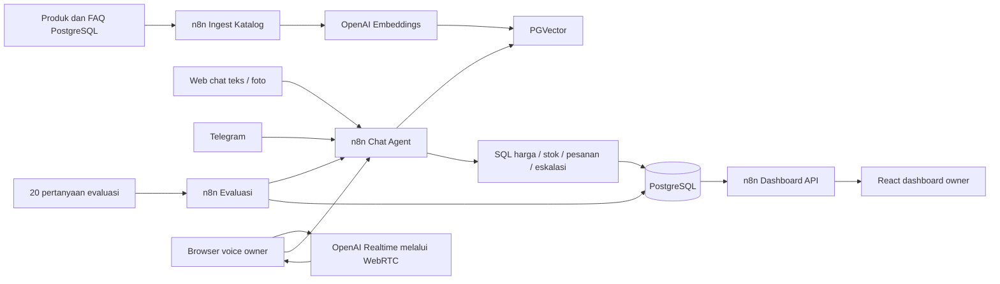

# Senja Tas — AI Sales Agent

Capstone project jalur **P2 + P3**: asisten penjualan AI untuk toko tas dan pouch, dengan workflow n8n dan dashboard owner.

## Masalah dan solusi

Pemilik toko kecil perlu menjawab pertanyaan katalog, harga, stok, dan kebijakan berulang kali sambil menangani pesanan. Pelanggan juga dapat mencari tas hanya dari foto. Senja Tas menghubungkan web chat dan Telegram ke agent yang mencari informasi toko, membaca harga/stok terkini, mencatat pesanan setelah konfirmasi, serta mencatat pertanyaan yang perlu ditinjau owner.

Toko Senja Tas adalah toko fiktif untuk demonstrasi: **30 produk, 5 dokumen FAQ/kebijakan, dan 20 pertanyaan evaluasi**. Angka tersebut adalah cakupan data, bukan hasil bisnis atau klaim akurasi.

## Akses demo

- [Web chat deployment](https://capstone-richard-khonan.duckdns.org/chat/)
- [Dashboard owner deployment](https://capstone-richard-khonan.duckdns.org/dashboard/) — memerlukan login owner; bukan demo publik tanpa izin.

Untuk mencoba dashboard tanpa akses server pemilik, ikuti [setup lokal](guide/local-setup.md). Dashboard lokal menggunakan instance n8n dan database milik pengguna sendiri. Chat AI memerlukan kredensial OpenAI; dashboard dengan data kosong tidak memerlukan panggilan AI.

## Arsitektur



Agent menggunakan retrieval katalog/FAQ, tool SQL untuk harga dan stok, memori percakapan PostgreSQL, dan validasi sumber jawaban. Foto dideskripsikan model vision sebelum pencarian katalog; hasilnya merupakan rekomendasi kemiripan. Pesanan memakai kunci unik sesi/SKU/jumlah/nama pembeli untuk mengurangi duplikasi. Evaluasi menggunakan model penilai dan tetap perlu pemeriksaan manual.

Voice adalah fitur tambahan untuk pertanyaan produk/kebijakan. Browser memperoleh token sementara dari workflow Realtime Token, lalu menghubungkan audio langsung ke OpenAI. Tool `tanya_toko` meneruskan pertanyaan ke Chat Agent. Pemesanan dilakukan melalui chat teks.

## Workflow dan teknologi

Seluruh export yang menjadi acuan integrasi ada di [workflows/](workflows/):

| Workflow       | Fungsi / endpoint produksi                                        |
| -------------- | ----------------------------------------------------------------- |
| Ingest Katalog | Embedding katalog dan FAQ; `POST /webhook/ingest`                 |
| Chat Agent     | Teks/foto, retrieval, tool SQL; `POST /webhook/chat`              |
| Entry Telegram | Input Telegram dan balasan melalui Chat Agent                     |
| Dashboard API  | `GET /webhook/pesanan`, `/webhook/tanpa-jawaban`, `/webhook/skor` |
| Evaluasi       | Pengujian 20 pertanyaan; `POST /webhook/eval`                     |
| Realtime Token | Token sementara voice; `POST /webhook/realtime-token`             |

Stack: n8n + external task runners, PostgreSQL 16 dengan pgvector, OpenAI, Telegram Bot API, React/TypeScript/Vite, Docker Compose; deployment menggunakan EC2 dan Caddy HTTPS. Export terkini memakai endpoint tanpa prefiks `ide05-`.

## Menjalankan proyek

Ikuti [panduan setup lokal lengkap](guide/local-setup.md) untuk Docker, inisialisasi data, pemetaan kredensial workflow, ingestion, frontend, dan pemeriksaan end-to-end. Dibutuhkan Docker Compose, Node.js 24/npm, dan kredensial layanan sendiri untuk fitur AI/Telegram.

```powershell
# Setelah backend dan workflow disiapkan sesuai panduan:
cd frontend
npm ci
Copy-Item .env.example .env.local
npm run dev
```

Buka `http://127.0.0.1:5173/dashboard/` atau `http://127.0.0.1:5173/chat/`. Konfigurasi contoh frontend mengarah ke n8n lokal pada port 5678.

- [Dokumentasi frontend dan kontrak API](frontend/README.md)
- [Deployment EC2](guide/ec2-deployment.md)
- [Deployment frontend](guide/frontend-deployment.md)
- [Demo dan rollback voice](guide/voice-demo.md)

## Batasan dan keamanan

Dashboard menampilkan hingga 100 pesanan/pertanyaan terbaru; bukan laporan seluruh transaksi. Pembayaran, editor katalog, dan perubahan status pesanan belum tersedia. Evaluasi chat tidak mengukur kualitas audio atau pencocokan foto. Jalankan live demo end-to-end sebelum presentasi, dengan data pembeli fiktif.

Jangan commit `.env`, API key, token Telegram, password, SSH key, backup database, atau export kredensial n8n. Gunakan `.env.example` dan buat kredensial sendiri di n8n; referensi credential pada workflow harus dipetakan ulang setelah import. Periksa juga pinned data dan execution data pada export sebelum publikasi. Jangan membuka dashboard operasional atau endpoint administratif hanya untuk membuat demo publik.
